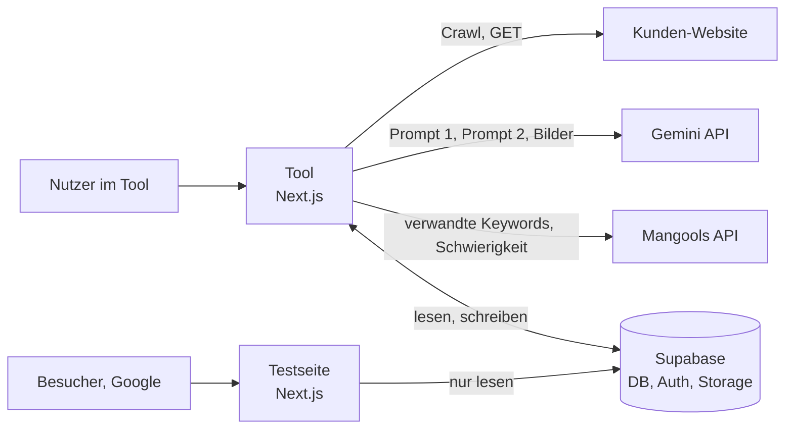
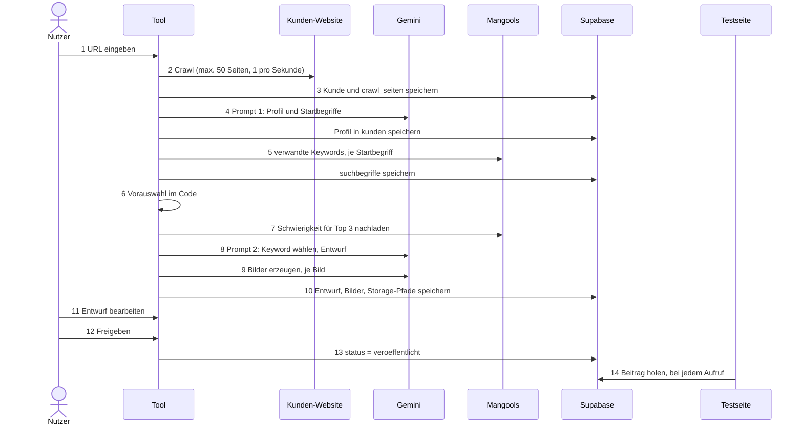
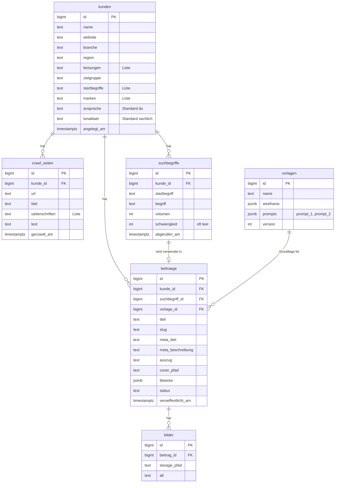

# Solution Design: SEO-Blog-Werkstatt

| | |
| :--- | :--- |
| **Auftraggeber** | KRUG software solutions GmbH, Grieskirchen |
| **Projekt** | Schulprojekt HTL Grieskirchen |
| **Grundlage** | Projektvorgaben SEO-Blog-Werkstatt, Stand 30.09.2026 |
| **Stand dieses Dokuments** | 07.10.2026, Entwurf |

**Lesehilfe:** Alles, was mit **Vorgabe** markiert ist, kommt direkt von KRUG und ist nicht verhandelbar. Alles mit **Entscheidung** ist unser eigener Lösungsvorschlag und kann im Team geändert werden. Ungeklärtes steht in Abschnitt 13.

---

## 1. Ziel und Umfang

Wir bauen zwei Anwendungen und ein Supabase-Projekt:

- **Tool** (später auf `seo.krugware.com`): findet zu einer Firmen-Website passende Keywords und erstellt daraus mit KI einen Blogbeitrag in festen Blöcken. Der Beitrag wird im Tool bearbeitet und freigegeben.
- **Testseite** (später auf `seitlich.at`): Website eines erfundenen Betriebs, die freigegebene Beiträge aus der Datenbank liest und als Blog anzeigt.
- **Supabase**: Datenbank (6 Tabellen), Login und Bildspeicher.

**Nicht im Umfang:** kein CMS wie WordPress, keine eigene REST-API für fremde Websites, kein Hosting durch uns. KRUG stellt beide Anwendungen online.

---

## 2. Systemkontext



| Komponente | Rolle | Quelle |
| :--- | :--- | :--- |
| Tool | Oberfläche, Login, gesamter Ablauf eines Beitrags | Vorgabe |
| Testseite | Firmenseite mit Blog, liest bei jedem Aufruf frisch aus Supabase | Vorgabe |
| Supabase | Datenbank, Auth, Storage-Bucket `blog-images` | Vorgabe |
| Gemini | Profil und Startbegriffe, Entwurf, Bilder | Vorgabe, Schlüssel von KRUG |
| Mangools | Verwandte Keywords und Schwierigkeit | Vorgabe, Schlüssel von KRUG |

---

## 3. Technologie

| Bereich | Technik | Quelle |
| :--- | :--- | :--- |
| Tool und Testseite | Next.js mit TypeScript | Vorgabe |
| Datenbank, Login, Bilder | Ein Supabase-Projekt, von uns eingerichtet | Vorgabe |
| Datenbank-Schema | Migrationen der Supabase CLI in `supabase/migrations`, Vorlagen in `supabase/seed.sql` | Vorgabe |
| Testseite Build | Cloudflare-Adapter `@opennextjs/cloudflare`, lokal mit `npm run preview` | Vorgabe |
| Supabase-Zugriff | `@supabase/supabase-js` | Vorgabe (als Beispiel genannt) |
| HTML-Parsing im Crawler | z. B. `cheerio` | Entscheidung |
| robots.txt auswerten | z. B. `robots-parser` | Entscheidung |
| Bilder nach WebP umwandeln | z. B. `sharp` im Tool (läuft auf Node) | Entscheidung |
| Validierung der KI-Antworten | z. B. `zod` | Entscheidung |

Bibliotheken mit "z. B." prüfen wir vor dem Einsatz gegen ihre offizielle Doku.

---

## 4. Repository-Struktur

**Vorgabe:** ein Repository mit den Ordnern `tool/`, `testseite/` und `supabase/`, dazu README.md und je eine `.env.example` in `tool/` und `testseite/`.

**Entscheidung** für die innere Struktur:

```text
/
├── README.md                Node.js-Version, Startbefehle, alle Umgebungsvariablen
├── CLAUDE.md                Projektregeln für KI-Werkzeuge
├── docs/
│   ├── solutiondesign.md    dieses Dokument
│   └── prompts.md           gemeinsame Prompt-Sammlung
├── supabase/
│   ├── migrations/          Tabellen, RLS, Bucket blog-images
│   └── seed.sql             Vorlage "Ratgeber Standard"
├── tool/
│   ├── .env.example
│   └── src/
│       ├── app/             Seiten und Server-Aktionen
│       ├── lib/
│       │   ├── crawler/
│       │   ├── gemini/
│       │   ├── mangools/
│       │   ├── vorauswahl/  reine Funktionen, mit Unit-Tests
│       │   ├── bloecke/     Block-Schema und Validierung
│       │   └── supabase/
│       └── components/      Editor, Listen, Formulare
└── testseite/
    ├── .env.example
    └── src/
        ├── app/             Startseite, Leistungen, Über uns, Kontakt, Blog
        └── components/
            └── block-renderer/
```

Block-Schema und Typen werden in beiden Anwendungen gebraucht. **Entscheidung:** Wir halten die Typdatei in beiden Ordnern gleich, statt ein gemeinsames Paket aufzusetzen. Das hält Build und Abgabe einfach, so wie KRUG sie testet.

---

## 5. Ablauf eines Beitrags

**Vorgabe:** Die Dienste werden genau in dieser Reihenfolge aufgerufen.



**Entscheidung: Ablauf in Etappen statt in einem Rutsch.** Ein kompletter Durchlauf dauert lange: allein der Crawl braucht bei 50 Seiten mindestens 50 Sekunden, dazu kommen mehrere KI-Aufrufe. Wir teilen ihn deshalb in Etappen, die der Nutzer im Tool nacheinander auslöst und deren Ergebnis jeweils gespeichert wird:

| Etappe | Schritte | Ergebnis in der Datenbank |
| :--- | :--- | :--- |
| A. Kunde anlegen und crawlen | 1 bis 3 | `kunden`, `crawl_seiten` |
| B. Profil erstellen | 4 | Profilfelder in `kunden` |
| C. Keywords finden | 5 bis 7 | `suchbegriffe` |
| D. Entwurf erstellen | 8 bis 10 | `beitraege`, `bilder`, Storage |
| E. Bearbeiten und freigeben | 11 bis 13 | `beitraege` |

Vorteile: Bricht eine Etappe ab, muss nur sie wiederholt werden. Der Nutzer sieht Zwischenergebnisse. Keine einzelne Anfrage läuft so lange, dass sie abbricht.

---

## 6. Komponenten des Tools

### 6.1 Kunde anlegen (Schritt 1)

**Vorgabe:** Name und URL sind Pflicht. Ansprache und Tonalität sind optional, Standard ist "du" und "sachlich".

### 6.2 Crawler (Schritte 2 bis 3)

**Vorgabe:**

- Nur die Domain des Kunden.
- robots.txt beachten.
- Höchstens 50 Seiten.
- Höchstens eine Anfrage pro Sekunde.
- Je Seite eine Zeile in `crawl_seiten` mit URL, Titel, Überschriften und Text.

**Entscheidung:**

1. robots.txt laden. Ist eine Seite gesperrt, wird sie übersprungen.
2. Mit der Startseite beginnen und interne Links in Breitensuche verfolgen, bis 50 Seiten erreicht sind.
3. Links normalisieren: ohne `#Anker`, ohne Tracking-Parameter, gleiche Schreibweise, damit keine Seite doppelt gezählt wird.
4. Je Seite auslesen:
   - `titel` aus `<title>`
   - `ueberschriften` aus `<h1>` bis `<h3>`
   - `text` aus dem Hauptinhalt, ohne `<script>`, `<style>`, `<nav>`, `<header>`, `<footer>`
5. Text je Seite auf eine feste Länge kürzen, damit Prompt 1 nicht unnötig viele Tokens verbraucht.

### 6.3 Profil und Startbegriffe (Schritt 4, Prompt 1)

**Vorgabe:**

- Eingabe: Text von Prompt 1 aus `vorlagen`, dann die Texte aus `crawl_seiten`.
- Ohne Websuche, Antwort als JSON mit `branche`, `region`, `leistungen`, `zielgruppe`, `startbegriffe`, `marken`.
- `startbegriffe`: 3 bis 5 Themen rund um die Leistungen, je 1 bis 3 Wörter, kein Name einer Leistung, kein Ortsname, kein Firmenname.
- Alle Felder werden in `kunden` gespeichert.
- Kein gültiges JSON: einmal neu anfragen, dann Fehlermeldung im Tool.

**Entscheidung:** Wir prüfen die Antwort im Code auf die Regeln (Anzahl, Wortanzahl). Verstößt sie dagegen, behandeln wir das wie ungültiges JSON.

### 6.4 Keywords holen (Schritte 5 und 7, Mangools)

**Vorgabe:**

| Endpunkt | Zweck | Wann |
| :--- | :--- | :--- |
| `GET /kwfinder/related-keywords` | bis zu 200 verwandte Keywords | je Startbegriff einmal, plus höchstens eine Erweiterung |
| `GET /kwfinder/serps` | Schwierigkeit (`serp.rank`) | für höchstens 3 Keywords |

- Basis-URL `https://api.mangools.com/v3`, Header `X-Access-Token`.
- Immer `location_id=2040` (Österreich) und `language_id=1001` (Deutsch).
- Aufrufe nacheinander, nie gleichzeitig.
- Höchstens 9 Aufrufe pro Durchlauf: 5 Startbegriffe, 1 Erweiterung, 3 Mal Schwierigkeit.
- Je Keyword eine Zeile in `suchbegriffe`. Gibt es das Keyword für den Kunden schon, nur die Werte aktualisieren.

**Entscheidung:**

- Ein Mangools-Client mit eingebautem Zähler. Er verweigert den 10. Aufruf, damit das Limit auch bei Programmfehlern hält.
- Kommt `seo` als `null` zurück, überschreiben wir eine schon vorhandene `schwierigkeit` nicht mit `null`.

### 6.5 Vorauswahl (Schritt 6, im Code)

**Vorgabe**, in dieser Reihenfolge:

**1. Filtern.** Ein Keyword fliegt raus, wenn eine Regel zutrifft:

| Regel | Trifft zu, wenn |
| :--- | :--- |
| Suchvolumen | `volumen` unter 20 |
| Schwierigkeit | `schwierigkeit` über 30. Ohne Wert trifft die Regel nicht zu |
| Marke | das Keyword enthält einen Eintrag aus `kunden.marken` |
| Kaufabsicht | das Keyword enthält "kaufen", "bestellen", "firma", "anbieter", "in der nähe" oder eine Leistung plus Ortsname. Keywords mit "kosten" oder "preis" bleiben |
| Schon bedient | das Keyword ist fast gleich wie ein Titel oder eine Überschrift in `crawl_seiten` oder `beitraege` |
| Schon verwendet | das Keyword ist schon einem Beitrag dieses Kunden zugeordnet |

"Fast gleich" heißt: gleich nach Kleinschreibung, ohne Umlaute und ohne Füllwörter.

**2. Kürzen.** Je Startbegriff die 8 Keywords mit dem höchsten Volumen behalten.

**3. Schwierigkeit nachladen.** Für die 3 Keywords mit dem höchsten Volumen ohne Schwierigkeit je einmal `serps` aufrufen. Wert über 30: Keyword fliegt raus.

**4. Weitergeben** an Prompt 2.

**5. Wenn nichts übrig bleibt:** Aus allen geholten Keywords das mit dem höchsten Volumen nehmen, das kein Startbegriff ist. Damit einmal `related-keywords` aufrufen, speichern und ab Schritt 1 wiederholen. Bleibt wieder nichts: Meldung "Kein passendes Keyword gefunden".

**Entscheidung zur Umsetzung:**

- Die Vorauswahl besteht nur aus reinen Funktionen ohne Datenbank- oder API-Zugriff. Dadurch lässt sich jede Regel mit Unit-Tests prüfen.
- Normalisierung für "fast gleich": Kleinbuchstaben, ä zu a, ö zu o, ü zu u, ß zu ss, Satzzeichen entfernen, Füllwörter entfernen, Leerzeichen zusammenfassen.
- Füllwörter-Liste als Konstante, zum Beispiel: der, die, das, ein, eine, für, mit, im, in, und, zu, von.
- Prüffall aus dem Beispiel-Durchlauf der Vorgaben: "schrank für dachschräge" und die Überschrift "Schrank für die Dachschräge" ergeben beide "schrank dachschrage" und gelten damit als fast gleich.
- Alle Mengen aus dem Beispiel-Durchlauf (547 geholt, 24 übrig) nehmen wir als Testfall, sobald wir passende Testdaten haben.

### 6.6 Keyword wählen und schreiben (Schritt 8, Prompt 2)

**Vorgabe:**

- Eingabe: Text von Prompt 2 aus `vorlagen`, dann ein JSON mit `keywords` (Keyword, Volumen, Schwierigkeit oder "unbekannt"), `leistungen`, `ansprache`, `tonalitaet` und `wireframe` aus `vorlagen`.
- Websuche an (`googleSearch`), Antwort als JSON mit `keyword`, `titel`, `slug`, `meta_titel`, `meta_beschreibung`, `auszug`, `bloecke`, `bilder`.
- `keyword` muss genau ein Eintrag aus der Liste sein.
- Je `image`-Block ein Eintrag in `bilder`, `name` gleich wie `path` im Block.
- Neue Zeile in `beitraege` mit `status = entwurf`, `suchbegriff_id` und `vorlage_id`.
- Kein gültiges JSON oder Keyword nicht in der Liste: einmal neu anfragen, dann Fehlermeldung.

**Entscheidung: Prüfung im Code** nach dem Parsen:

| Prüfung | Regel |
| :--- | :--- |
| `titel` | höchstens 70 Zeichen |
| `slug` | nur `a-z`, `0-9` und `-` |
| `meta_titel` | höchstens 60 Zeichen |
| `meta_beschreibung` | höchstens 160 Zeichen |
| `bloecke` | mindestens 3, nur die 5 erlaubten Typen, Felder laut Abschnitt 8 |
| `bilder` | passt eins zu eins zu den `image`-Blöcken |

- Verstöße behandeln wir wie ungültiges JSON: einmal neu anfragen, dann Fehlermeldung.
- Lange Gedankenstriche ersetzen wir im Code durch normale Bindestriche, statt deswegen neu anzufragen.
- Ist der Slug für den Kunden schon vergeben, hängen wir `-2`, `-3` usw. an.

### 6.7 Bilder (Schritte 9 und 10)

**Vorgabe:**

- Ein Gemini-Aufruf je Eintrag in `bilder`, mit der `beschreibung` als Eingabe.
- Danach sofort als WebP in zwei Breiten (800 und 1600) in den Bucket `blog-images`.
- Pfad: `{kunde_id}/{beitrag_id}/{name}-800.webp` und `-1600.webp`.
- Eine Zeile je Bild in `bilder`.
- Schritt 10 ersetzt in jedem `image`-Block den `name` durch den Storage-Pfad. Das erste Bild wird `cover_pfad`.
- Keine echten Personen, keine Logos, keine nachgebauten Produkte des Kunden, eher Symbolbilder.

**Entscheidung:**

- In `bilder.storage_pfad`, `cover_pfad` und im `image`-Block speichern wir den Pfad der 1600er-Version. Die 800er-Version leitet die Testseite daraus ab.
- Die Bildregeln (keine Personen, keine Logos) hängen wir im Code an jede Bildbeschreibung an, damit sie nicht von der KI-Antwort abhängen.

### 6.8 Editor und Freigabe (Schritte 11 bis 13)

**Vorgabe:**

- Jeden Block ändern, Blöcke verschieben, Bild neu erzeugen.
- Freigabe setzt `status` auf `veroeffentlicht`.

**Entscheidung:**

- Beim Freigeben setzen wir zusätzlich `veroeffentlicht_am` auf den aktuellen Zeitpunkt.
- Vor dem Speichern prüft der Editor dieselben Regeln wie nach Prompt 2. Ein ungültiger Beitrag lässt sich nicht freigeben.
- "Bild neu erzeugen" ruft Gemini erneut mit derselben Beschreibung auf und überschreibt beide WebP-Dateien unter demselben Pfad.

---

## 7. Datenmodell

**Vorgabe:** 6 Tabellen mit den unten genannten Spalten. Login läuft über Supabase Auth, dafür gibt es keine eigene Tabelle.

**Entscheidung:** Datentypen, Standardwerte und die genaue Form der Einschränkungen.



Listen speichern wir als Postgres-Arrays (`text[]`).

**Einschränkungen in der Datenbank:**

| Regel | Umsetzung | Quelle |
| :--- | :--- | :--- |
| `beitraege.status` ist `entwurf`, `veroeffentlicht` oder `offline` | `check`-Constraint, Standard `entwurf` | Vorgabe |
| Jedes Keyword nur einmal pro Kunde in einem Beitrag | `unique (suchbegriff_id)` in `beitraege` | Vorgabe |
| `suchbegriffe.begriff` pro Kunde eindeutig | `unique (kunde_id, begriff)`, Speichern per Upsert | Vorgabe |
| `beitraege.slug` pro Kunde eindeutig | `unique (kunde_id, slug)` | Vorgabe |
| `slug` nur `a-z`, `0-9`, `-` | `check`-Constraint mit regulärem Ausdruck | Vorgabe |
| Längen von `titel`, `meta_titel`, `meta_beschreibung` | `check`-Constraints (70, 60, 160) | Vorgabe |
| Löschen eines Kunden löscht seine Daten | `on delete cascade` auf den Fremdschlüsseln | Entscheidung |

**Storage:** Bucket `blog-images`, Pfade `{kunde_id}/{beitrag_id}/{name}-800.webp` und `-1600.webp` (Vorgabe). Der Bucket ist öffentlich lesbar, weil die Testseite die Bilder über die öffentliche Adresse lädt (Vorgabe).

**Seed:** `supabase/seed.sql` legt die Vorlage "Ratgeber Standard", Version 1, mit Wireframe und den Texten von Prompt 1 und Prompt 2 an (Vorgabe). **Entscheidung:** Das Tool verwendet die höchste Version dieser Vorlage.

---

## 8. Block-Schema

**Vorgabe:** Der Inhalt eines Beitrags steht in `beitraege.bloecke` als Liste von Blöcken. Es gibt genau fünf Typen:

| Typ | Felder | Regel |
| :--- | :--- | :--- |
| `heading` | `level` (2 oder 3), `text` | keine Ebene 1, die kommt aus `titel` |
| `text` | `text` | nur `**fett**`, `*kursiv*`, `[Link](url)`, kein HTML |
| `image` | `path`, `alt`, `caption` (optional) | Pfad im Storage, Alt-Text Pflicht |
| `list` | `style` (`bullet` oder `number`), `items` | 2 bis 12 Punkte |
| `faq` | `items` mit `q` und `a` | Testseite gibt sie zusätzlich als FAQPage-Daten aus |

**Entscheidung:** Ein gemeinsamer TypeScript-Typ in Tool und Testseite:

```ts
type Block =
  | { type: "heading"; level: 2 | 3; text: string }
  | { type: "text"; text: string }
  | { type: "image"; path: string; alt: string; caption?: string }
  | { type: "list"; style: "bullet" | "number"; items: string[] }
  | { type: "faq"; items: { q: string; a: string }[] };
```

Dazu ein Validierungsschema (z. B. mit `zod`), das Tool und Testseite gleich verwenden. So prüft das Tool beim Speichern, und die Testseite überspringt einen kaputten Block, statt abzustürzen.

---

## 9. Schnittstellen

### 9.1 Gemini

**Vorgabe:** `POST /v1beta/models/{model}:generateContent`, Header `x-goog-api-key`. Drei Arten von Aufrufen:

| Aufruf | Websuche | Antwort |
| :--- | :--- | :--- |
| Prompt 1: Profil und Startbegriffe | aus | JSON nach Schema |
| Prompt 2: Keyword und Entwurf | an (`googleSearch`) | JSON nach Schema |
| Bild, je Eintrag in `bilder` | nicht relevant | Bilddatei |

Die Antwort steht als Text in `candidates[0].content.parts[0].text`.

**Entscheidung:** Die Modellnamen für Text und Bild kommen aus Umgebungsvariablen, weil das Modell noch nicht feststeht.

**Zu prüfen vor der Umsetzung:** Die Request-Bodies in den Vorgaben verwenden `generationConfig.responseFormat`. Wir gleichen Feldnamen und die Kombination aus Websuche und JSON-Schema in einem Aufruf früh mit der offiziellen Gemini-Doku und einem Testaufruf ab (siehe Abschnitt 13).

### 9.2 Mangools

Siehe Abschnitt 6.4.

### 9.3 Testseite liest aus Supabase

**Vorgabe:** Direkt mit `@supabase/supabase-js`, nur Beiträge mit `status = veroeffentlicht`:

```ts
// Blog-Übersicht
supabase.from("beitraege")
  .select("titel, slug, auszug, cover_pfad, veroeffentlicht_am")
  .eq("kunde_id", KUNDE_ID)
  .eq("status", "veroeffentlicht")
  .order("veroeffentlicht_am", { ascending: false });

// Ein Beitrag
supabase.from("beitraege")
  .select("*")
  .eq("kunde_id", KUNDE_ID)
  .eq("slug", slug)
  .eq("status", "veroeffentlicht")
  .single();
```

---

## 10. Testseite

**Vorgabe:**

- Ein erfundener Betrieb mit klaren Leistungen und Region, damit Crawl und Startbegriffe funktionieren.
- Mindestens: Startseite, 3 Leistungsseiten, Über uns, Kontakt, Blog.
- `/blog`: alle veröffentlichten Beiträge mit Titel, Auszug und Cover-Bild.
- `/blog/{slug}`: ein Beitrag.
- Jeder der fünf Block-Typen wird richtig angezeigt, auch fett, kursiv und Links im Absatz.
- `meta_titel` in `<title>`, `meta_beschreibung` in `<meta name="description">`.
- Liest bei jedem Aufruf frisch aus Supabase, ohne Cache.
- Bekommt die id ihres Kunden über die Umgebungsvariable `KUNDE_ID`.

**Entscheidung:**

| Thema | Umsetzung |
| :--- | :--- |
| Kein Cache | Blog-Seiten dynamisch rendern (in Next.js z. B. über die Route-Einstellung `dynamic`, gegen die Next.js-Doku prüfen) |
| Meta-Daten | `generateMetadata` je Beitrag aus `meta_titel` und `meta_beschreibung` |
| Überschrift H1 | aus `titel`, Blöcke beginnen bei H2 |
| Absatz-Formatierung | eigener kleiner Parser nur für `**`, `*` und `[ ](url)`. Alles andere wird als Text ausgegeben, nie als HTML. Links nur mit `http` oder `https` |
| Bilder | `` mit `srcset` aus der 800er- und 1600er-Version, `alt` Pflicht, `caption` als `<figcaption>` |
| FAQ | sichtbar als aufklappbare Fragen, zusätzlich ein `<script type="application/ld+json">` mit `FAQPage` nach schema.org |
| Unbekannter Slug | 404-Seite |
| Kaputter Block | wird übersprungen, Rest der Seite bleibt sichtbar |

Der eigene Absatz-Parser ist eine Sicherheitsentscheidung: Würden wir KI-Text als HTML ausgeben, könnte ein Beitrag Skripte in die Seite bringen.

---

## 11. Sicherheit und Konfiguration

### 11.1 Zugriffsregeln (RLS)

**Vorgabe:** Die Migrationen enthalten alle Zugriffsregeln (RLS) und den Bucket `blog-images`.

**Entscheidung:**

| Wer | Tabellen | Rechte |
| :--- | :--- | :--- |
| Angemeldet im Tool | alle 6 Tabellen | lesen, anlegen, ändern, löschen |
| Nicht angemeldet (Testseite) | `beitraege` | nur lesen, nur Zeilen mit `status = 'veroeffentlicht'` |
| Nicht angemeldet (Testseite) | übrige 5 Tabellen | kein Zugriff |
| Angemeldet im Tool | Bucket `blog-images` | hochladen, überschreiben, löschen |
| Alle | Bucket `blog-images` | lesen über die öffentliche Adresse |

Die Testseite filtert zusätzlich nach `KUNDE_ID`. Die RLS-Regel sorgt dafür, dass Entwürfe auch bei einem Programmfehler nie öffentlich sichtbar werden.

**Risiko:** Ist die Registrierung im Tool offen, bekommt jeder mit einem Konto vollen Zugriff auf alle Kunden. Deshalb steht die Registrierungsregel in Abschnitt 13 als offene Frage.

### 11.2 Umgebungsvariablen

**Vorgabe:** Adressen und Schlüssel kommen nur aus Umgebungsvariablen, nichts davon steht im Code. Das gilt auch für die Adressen von Gemini und Mangools.

**Entscheidung** zu den Namen:

| Variable | Tool | Testseite | Inhalt |
| :--- | :---: | :---: | :--- |
| `NEXT_PUBLIC_SUPABASE_URL` | x | x | Adresse des Supabase-Projekts |
| `NEXT_PUBLIC_SUPABASE_ANON_KEY` | x | x | öffentlicher Supabase-Schlüssel, durch RLS abgesichert |
| `GEMINI_API_URL` | x | | Basis-Adresse der Gemini-API |
| `GEMINI_API_KEY` | x | | Schlüssel von KRUG |
| `GEMINI_TEXT_MODEL` | x | | Modell für Prompt 1 und 2 |
| `GEMINI_IMAGE_MODEL` | x | | Modell für Bilder |
| `MANGOOLS_API_URL` | x | | `https://api.mangools.com/v3` |
| `MANGOOLS_API_KEY` | x | | Schlüssel von KRUG |
| `KUNDE_ID` | | x | id des Kunden der Testseite (Vorgabe) |

- Gemini- und Mangools-Aufrufe laufen nur auf dem Server des Tools, die Schlüssel kommen nie in den Browser.
- Werte stehen lokal in `.env.local`, die in `.gitignore` steht. `.env.example` enthält nur die Namen.
- Wie Umgebungsvariablen beim Cloudflare-Build der Testseite gelesen werden, prüfen wir in der Doku von `@opennextjs/cloudflare`.

---

## 12. Fehlerbehandlung

| Fall | Verhalten | Quelle |
| :--- | :--- | :--- |
| Gemini liefert kein gültiges JSON | einmal neu anfragen, dann Fehlermeldung im Tool | Vorgabe |
| Prompt 2 wählt ein Keyword außerhalb der Liste | einmal neu anfragen, dann Fehlermeldung | Vorgabe |
| Antwort verletzt Längen- oder Block-Regeln | wie ungültiges JSON | Entscheidung |
| Mangools 429 mit RateLimit | so viele Sekunden warten wie `retry_after`, dann gleich nochmal | Vorgabe |
| Mangools 429 mit CreditLimit | Durchlauf abbrechen, Meldung im Tool | Vorgabe |
| Nach Erweiterung kein Keyword übrig | Meldung "Kein passendes Keyword gefunden" | Vorgabe |
| Seite beim Crawl nicht erreichbar | überspringen, Crawl läuft weiter | Entscheidung |
| robots.txt sperrt alles | Meldung im Tool, kein Profil möglich | Entscheidung |
| Bild-Erzeugung schlägt fehl | Entwurf trotzdem speichern, Bild im Editor neu erzeugen | Entscheidung |

Jede Fehlermeldung im Tool sagt, in welcher Etappe es passiert ist und ob die Etappe wiederholt werden kann.

---

## 13. Offene Punkte

### Fragen an KRUG

- [ ] Welches Gemini-Modell für Text, welches für Bilder?
- [ ] Wie kommt ein Beitrag in den Status `offline`? Im Ablauf gibt es keinen Schritt dafür. Unser Vorschlag: ein Knopf "Offline nehmen" im Editor.
- [ ] Wer darf sich im Tool registrieren? Unser Vorschlag: öffentliche Registrierung aus, Konten werden angelegt oder auf bestimmte E-Mail-Adressen beschränkt.
- [ ] Wie groß ist das tägliche Mangools-Kontingent für die Entwicklung?
- [ ] Storage-Pfad: Die Vorgabe sagt `{kunde_id}/{beitrag_id}/...`, das Beispiel zeigt `k_1/b_1/...`. Welche Form gilt?
- [ ] "Ohne Umlaute" beim Vergleich: ä zu a oder ä zu ae? Wir haben ä zu a gewählt.
- [ ] Gibt es eine feste Füllwörter-Liste?
- [ ] "Leistung plus Ortsname" bei der Kaufabsicht: Unser Vorschlag ist, dass ein Keyword rausfliegt, wenn es ein Wort aus einer Leistung und ein Wort aus `region` enthält. Passt das?

### Technische Risiken, früh zu testen

- [ ] Gemini-Request-Format aus den Vorgaben gegen die offizielle Doku prüfen.
- [ ] Websuche und JSON-Schema in einem Aufruf (Prompt 2) mit dem gewählten Modell testen.
- [ ] Ein Mangools-Aufruf je Endpunkt, Antwortformat und 429-Verhalten prüfen.
- [ ] Testseite mit `@opennextjs/cloudflare` bauen und `npm run preview` starten, bevor viel Code darauf aufbaut.

---

## 14. Abgabe

**Vorgabe**, als Checkliste:

- [ ] Repository mit `tool/`, `testseite/`, `supabase/`
- [ ] README.md mit Node.js-Version, Startbefehlen und allen Umgebungsvariablen
- [ ] `.env.example` in `tool/` und `testseite/`, ohne Werte
- [ ] Migrationen in `supabase/migrations`: alle Tabellen, RLS, Bucket `blog-images`
- [ ] Vorlagen in `supabase/seed.sql`
- [ ] Tool läuft mit `npm install`, `npm run build`, `npm start` ohne weitere Schritte
- [ ] Testseite baut mit `@opennextjs/cloudflare` und läuft mit `npm run preview`
- [ ] Keine Adressen oder Schlüssel im Code
- [ ] Test auf leerem Supabase-Projekt: Migrationen einspielen, `seed.sql` ausführen, Tool und Testseite starten, einen Durchlauf komplett machen
- [ ] KRUG in das Repository einladen
